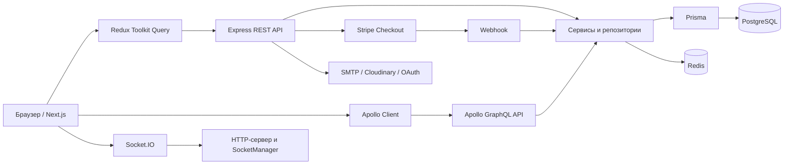

# Архитектура GameZone и руководство для разработки

Документ описывает текущий код, а не целевое состояние. Инструкция запуска — в [README.md](README.md). Магазин переводится с универсальной тематики на игровую; переход ещё не завершён.

## 1. Общая схема

Это монорепозиторий с двумя отдельными Node.js-приложениями, а не настроенный npm workspace. У клиента и сервера свои `package.json`, lock-файлы, зависимости и команды. Корневые зависимости обслуживают Git-инструменты.



В демо REST и GraphQL подменяются клиентскими обработчиками. PostgreSQL, Redis и Stripe в таком режиме не участвуют.

## 2. Карта репозитория

| Путь | Ответственность |
| --- | --- |
| `src/client/app` | Next.js App Router, страницы, компоненты и состояние |
| `src/client/app/(public)` | Каталог, карточки товаров, блоки главной |
| `src/client/app/(auth)` | Вход, регистрация, восстановление пароля |
| `src/client/app/(private)` | Профиль, заказы, чат и dashboard |
| `src/client/app/components` | Общие UI-компоненты, layout, guards |
| `src/client/app/store/apis` | Доменные endpoint-описания RTK Query |
| `src/client/app/store/slices` | Авторизация, уведомления, базовый API |
| `src/client/app/hooks/catalog` | Загрузка каталога и fallback |
| `src/client/app/lib/demo` | Имитация API, авторизация, состояние и фикстуры |
| `src/client/app/data/demo/gaming.json` | Общие исходные данные игровых товаров |
| `src/server/src/server.ts` | Точка входа, alias `@`, запуск HTTP |
| `src/server/src/app.ts` | Express middleware, зависимости, REST, GraphQL, Socket.IO |
| `src/server/src/modules` | Доменные модули backend |
| `src/server/src/infra` | PostgreSQL, Redis, Stripe, OAuth, Cloudinary, Socket.IO, логирование |
| `src/server/src/shared` | Общие middleware, ошибки, утилиты, шаблоны писем |
| `src/server/src/graphql` | Подключение GraphQL |
| `src/server/prisma` | Схема БД и история миграций |
| `src/server/seeds/seed.ts` | Игровые товары и тестовые аккаунты |
| `src/docker-compose.yml` | Окружение Docker |

Скобки в route groups Next.js не входят в URL: например, `(private)/dashboard` соответствует `/dashboard`. Само имя `(private)` не защищает страницу — нужны guards и проверки сервера.

## 3. Клиент

`app/layout.tsx` задаёт русский язык документа, метаданные и подключает `ClientProviders`. Провайдеры добавляют Apollo, Redux, восстановление авторизации и уведомления.

Redux store содержит `auth`, `toasts` и RTK Query cache. `ApiSlice.ts` отправляет запросы с `credentials: include`; при 401 пытается вызвать `/auth/refresh-token`, затем повторяет запрос либо сбрасывает авторизацию. Доменные API расширяют общий slice. После изменения endpoint проверяйте связанные cache tags и обновление UI.

Apollo Client используется для GraphQL, в том числе каталога и аналитики. Адрес вычисляется из `API_BASE_URL`; cookies включены. Он имеет отдельный кэш, поэтому изменения RTK Query не означают автоматического обновления всех GraphQL-данных.

`hooks/catalog` выбирают реальные или статические данные. Главная группирует товары по флагам `isNew`, `isFeatured`, `isTrending`, `isBestSeller`. Компоненты фильтров и GraphQL необходимо менять согласованно с сервером и демо-обработчиками.

Tailwind версии 4 подключён через CSS; общие переменные и стили находятся в `app/globals.css`. Новый баннер построен на CSS без сторонних логотипов. Полная тёмная тема ещё не реализована.

### Конфигурация интерфейса

`app/lib/constants/config.ts` содержит URL API/Socket.IO, `STORE_NAME`, `STORE_CURRENCY`, `formatPrice`. Значения по умолчанию — GameZone, KZT, ru-RU, ₸. `NEXT_PUBLIC_*` доступны браузеру, в production применяются при сборке: туда нельзя помещать секреты.

`hooks/ui/useFormatPrice.ts` использует общий `formatPrice` с KZT по умолчанию. Общего завершённого русского словаря ещё нет; строки остаются в компонентах. Не считайте `lang="ru"` признаком полной локализации.

## 4. Сервер

Обычный модуль организован так:

```text
routes → middleware / DTO → controller → service → repository → Prisma
```

- `routes`: HTTP-маршруты и цепочки авторизации/валидации;
- `dto`: структуры и ограничения входных данных;
- `controller`: HTTP-контекст и вызов бизнес-операции;
- `service`: бизнес-правила;
- `repository`: запросы к БД;
- `factory`: сборка зависимостей;
- `types`: типы модуля.

Это соглашение, а не жёсткая изоляция: часть сервисов обращается к Prisma напрямую. При изменениях следуйте устройству конкретного модуля, не проводите общий рефакторинг без отдельной задачи.

`app.ts` подключает БД, создаёт HTTP-сервер и SocketManager. Stripe webhook регистрируется с raw-body до JSON parser — этот порядок нужен для проверки подписи. Далее подключаются cookies, Redis-сессии, Passport, CORS, защитные middleware, REST и GraphQL.

REST монтируется под `/api/v1`; список модулей находится в `routes/v1/index.ts`: users, auth, products, variants, categories, attributes, cart, checkout, orders, payments, transactions, shipment, addresses, reviews, reports, analytics, logs, sections, chat. Наличие маршрута не означает публичный доступ — смотрите middleware каждого route.

Ошибки проходят через `shared/errors/globalError.ts`; общие классы ошибок находятся рядом. Логирование реализовано через Winston и middleware. Redis используется в том числе для сессий и утилит авторизации; данные магазина находятся в PostgreSQL.

## 5. Модель данных

Источник истины — `src/server/prisma/schema.prisma`.

| Сущности | Назначение и связи |
| --- | --- |
| User | Email, bcrypt-хэш, роль, связи с заказами, корзинами, чатами |
| Product → ProductVariant | Общая карточка → продаваемые SKU с ценой, остатком и изображениями |
| Category → Product | Категория товара; в схеме нет дерева parent/children |
| Attribute → AttributeValue | Вид характеристики и допустимые значения |
| ProductVariantAttribute | Связь варианта с характеристикой и значением |
| CategoryAttribute | Характеристики категории и признак обязательности |
| Cart → CartItem | Корзина пользователя или гостя, позиции с variantId |
| CartEvent / Interaction | События для аналитики |
| Order → OrderItem | Заказ и позиции с количеством/ценой |
| Payment / Transaction / Shipment / Address | Оплата, статус транзакции, доставка и адрес заказа |
| StockMovement / Restock | Движение и пополнение остатков |
| Review | Отзыв пользователя о товаре |
| Chat → ChatMessage | Диалог и сообщения с отправителем |
| Report / Log / Section | Отчёты, логи и блоки контента |

Игровые характеристики используют существующие Attribute-модели: платформа, жанр, рейтинг, язык, издание, дата выхода, бренд, подключение, совместимость, цвет, гарантия и параметры монитора. Новая миграция для этого этапа не создавалась.

Платформенные категории дисков сейчас плоские. Предзаказ не выделен отдельным полем. Цена хранится как Float без кода валюты — это ограничение при дальнейшем развитии платежей. Изменения схемы оформляйте новой миграцией, не редактируйте применённые миграции.

## 6. Авторизация и роли

Пароли хэшируются bcrypt с 12 раундами (`shared/utils/auth/passwordUtils.ts`). `protect.ts` проверяет access-token из cookie и получает актуальную роль пользователя из БД. `authorizeRole` проверяет список разрешённых ролей, `authorizeRoleHierarchy` — иерархию USER < ADMIN < SUPERADMIN и запрет изменения равного/старшего пользователя.

На клиенте есть PermissionGuard, AdminActionGuard и RoleHierarchyGuard. Они управляют доступностью UI, но не заменяют backend-проверки. При новом административном endpoint проверяйте права на обоих уровнях. Не добавляйте исключения по email конкретного администратора.

Seed создаёт Санжара, Батырхана и Елдара с одинаковой ролью SUPERADMIN. В модели User нет поля подтверждения email; `emailVerified` есть в демо-типах и не соответствует полю PostgreSQL.

Полная проверка всех административных операций под каждым аккаунтом ещё не проведена. Прежний отладочный вывод токена и decoded payload в `protect.ts` убран.

## 7. Основные потоки

### Каталог и корзина

Страница запрашивает товары через каталоговые hooks/GraphQL либо получает fallback. Пользователь выбирает конкретный вариант SKU; корзина хранит variantId и количество. Гостевая корзина связана с сессией, пользовательская — с userId. Правила добавления и обновления находятся в модуле cart и его репозитории.

### Оплата и заказ

Checkout получает корзину, проверяет остатки и создаёт Stripe Checkout Session. Цена преобразуется в минимальные денежные единицы умножением на 100. Redirect ведёт пользователя в платёжный сценарий; серверный webhook обрабатывает события Stripe. При изменении процесса проверяйте также `modules/webhook`, order, payment, transaction и обработку повторных событий. Сам redirect на страницу заказов не является доказательством оплаты.

Текущее ограничение: checkout жёстко задаёт `usd`, а игровой seed использует цены, задуманные как тенге. Автоматической конвертации нет. Разрешённые страны доставки сейчас US, CA, MX, EG — Казахстан отсутствует. До реальных платежей требуется согласовать валюту, единицы цены, страны и проверить webhook в тестовом режиме.

### Чат

Чат использует REST-модуль chat для операций с данными и Socket.IO для событий реального времени. Серверный SocketManager находится в `infra/socket/socket.ts`, клиентские подключения — в `hooks/network/useSocket.ts` и компонентах чата. В дереве клиента есть две реализации ChatContainer: перед правкой проверяйте, какая импортируется нужной страницей. Демо не заменяет полноценный живой чат.

## 8. Демо-режим и seed

| Режим | Поведение |
| --- | --- |
| `NEXT_PUBLIC_DEMO_MODE=true` | RTK Query использует demoBaseQuery, Apollo — demoApolloLink; вход/корзина/админка/checkout имитируются |
| `NEXT_PUBLIC_USE_DEMO_CATALOG=true` | Статический каталог; остальные операции требуют API, если полный demo выключен |
| API недоступен | Каталог может перейти на fallback без полноценного автономного магазина |

`lib/demo/store.ts` хранит состояние под ключом `demo-store-v1`; выбранный пользователь — `demo-session-user-id`. Это локальные данные браузера. Изменение JSON или серверный seed не мигрируют уже сохранённое демо-состояние.

`data/demo/gaming.json` — общий источник 54 товаров и 18 категорий. Клиентский `catalog.ts` преобразует JSON в UI-типы; серверный seed читает его через относительный файловый путь. Это явная связь между пакетами: при серверном Docker/deploy нужно включить файл или позднее вынести данные в общий пакет. Сейчас Dockerfile сервера сам по себе этого не делает.

Seed выполняет upsert в транзакции: аккаунты по email, категории и атрибуты по slug, товары по slug, варианты по SKU, связи по составным ключам. Пароли тестовых аккаунтов, цены и остатки обновляются при повторе. Заказы и прочие данные не очищаются. При неизменных входных данных дубликаты этих записей не создаются; при переименовании slug/email старые записи сохранятся. Удалённые из JSON товары и устаревшие связи характеристик автоматически не удаляются.

Защита production проверяет стандартные пароли администраторов до записи в БД. Это не делает seed пригодным для production: тестовый покупатель сохраняет фиксированный пароль.

## 9. Интеграции и окружение

Секреты и адреса backend перечислены в `src/server/.env.example`; клиентские флаги — в `src/client/.env.example`. Пользовательские .env не перезаписывайте. Серверные команды запускайте из `src/server`, чтобы относительные пути окружения соответствовали ожиданиям.

Stripe и OAuth инициализируются без условного отключения. Redis и PostgreSQL нужны для полноценного сервера. SMTP обслуживает письма, Cloudinary — загрузки. Для отладки запуска сначала проверьте health endpoints, затем Network/cookies в браузере. Не полагайтесь только на видимый каталог: fallback может скрыть отсутствие API.

В Compose сервер имеет файловый контекст только `src/server`, а `env_file` указывает на `src/.env`. Поэтому рекомендуемый локальный путь — Docker только для db/redis, Node-процессы клиента и сервера на хосте. Полную контейнеризацию текущего seed нужно отдельно привести в порядок.

## 10. Как вносить изменения

1. Найдите страницу, API/hook, серверный модуль и соответствующие Prisma-модели.
2. Проверьте реальный и демо-сценарии: изменение только серверного endpoint не обновляет demo handlers.
3. Для схемы добавьте миграцию, сгенерируйте Prisma Client и обновите DTO/репозитории.
4. Согласуйте типы запросов и ответов с RTK Query/GraphQL и локальными demo types.
5. Проверьте права на сервере и клиенте, инвалидацию кэша, ошибки и пустые состояния.
6. Запустите TypeScript, lint клиента и сборки отдельно, затем сценарий в браузере.
7. Обновите эти документы при изменении запуска, схемы, переменных или архитектуры.

Для новых игровых товаров редактируйте общий JSON. Для характеристик поддерживайте согласованность ключей `attributes` и значений товаров. Реальные изображения должны иметь разрешение на использование; текущие варианты имеют пустой список изображений и рассчитывают на UI fallback.

Для переводов предстоит создать общий словарь и последовательно подключить формы, уведомления, письма, статусы и API-ошибки. Не переводите внутренние enum/ключи протокола вместо отображаемых подписей. Не меняйте проверку сложности пользовательских паролей ради тестовых аккаунтов.

## 11. Проверки и ближайшие задачи

Последние результаты до этого документа: server `tsc --noEmit` и build прошли; client build прошёл, но самостоятельные TypeScript/lint выявили ошибки. Next.js настроен игнорировать оба класса ошибок при build. Отключать проверки ради зелёной сборки дальше не следует: сначала устраните ошибки, затем уберите обходы.

Подтверждение на чистой PostgreSQL, повторный seed, браузерные проверки покупателя/трёх администраторов, Stripe и Socket.IO ещё не выполнены. Автоматизированный тестовый сценарий для этого этапа не добавлялся.

Приоритеты продолжения:

- Исправить клиентские TypeScript/lint и включить проверки сборки.
- Развести тестовый seed и production, устранить логирование токенов и проверить cookie-политику для локального HTTP.
- Сделать интеграции отключаемыми и обеспечить самостоятельную серверную упаковку каталога.
- Согласовать KZT/Stripe и страны доставки до любых реальных платежей.
- Завершить русский интерфейс, API-ошибки, письма и единое форматирование.
- Реализовать игровые фильтры, сортировку, предзаказы, платформенные блоки и тёмную тему.
- Синхронизировать устаревшие демо-заказы/фикстуры и выполнить полный сценарий покупки и администрирования.

Документирование не означает, что перечисленные ограничения устранены.
